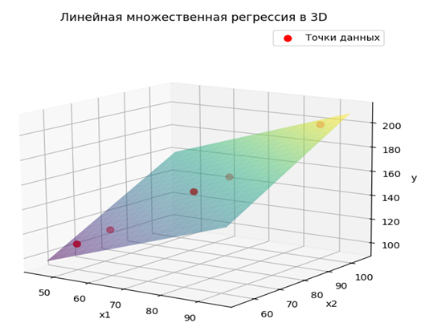
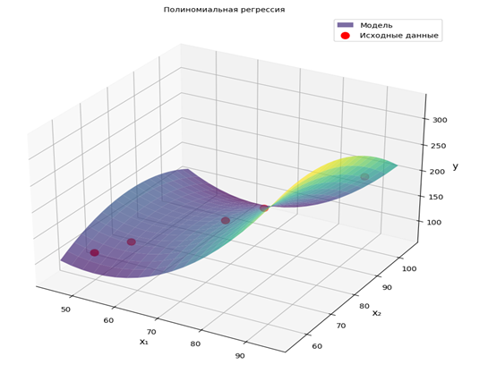

# Лабораторная работа №4. Регрессионная аппроксимация


Лабораторная работа по дисциплине «Методы машинного обучения», кафедра «Кибербезопасность информационных систем», ДГТУ, 2025.

## Цель

Построить модели линейной и полиномиальной регрессии для аппроксимации зависимостей между переменными методом наименьших квадратов.

---

### 1. Линейная регрессия (множественная)

#### Идея

Линейная регрессия моделирует зависимость целевой переменной $y$ от нескольких независимых признаков $x_1, x_2$. Метод подбирает такие веса модели, при которых минимизируется суммарная квадратичная ошибка (функция потерь) между предсказанными и реальными значениями.

#### Формула модели

Общий вид уравнения линейной регрессии для двух признаков:


$$y = w_1 x_1 + w_2 x_2 + w_0$$


где $w_1, w_2$ — коэффициенты при признаках, а $w_0$ — свободный член (смещение).

#### Функция потерь (ошибки)

Для набора из $N$ точек функция среднеквадратичной ошибки (в развернутом виде для минимизации) записывается как сумма квадратов разностей:


$$L(w_1, w_2, w_0) = \sum_{i=1}^{N} \left( w_1 x_{1i} + w_2 x_{2i} + w_0 - y_i \right)^2$$

#### Алгоритм реализации в коде (`normal_equations_method`)

1. **Вычисление сумм:** Происходит подсчет необходимых статистик по исходным массивам данных: сумм квадратов признаков, их попарных произведений и произведений с целевой переменной $y$.
2. **Составление нормальной системы уравнений:** Частные производные функции потерь по каждому из весов приравниваются к нулю, что формирует матрицу коэффициентов $A$ и вектор правой части $b$.
3. **Решение системы:** С помощью функции `np.linalg.solve(A, b)` находится вектор оптимальных весов $w = [w_1, w_2, w_0]$.

---

### 2. Полиномиальная регрессия

#### Идея

Если связь между переменными нелинейна, простая линейная регрессия дает большую погрешность. Полиномиальная регрессия расширяет пространство признаков за счет добавления степеней ($x_1^2, x_2^2$) и перекрестных членов ($x_1 x_2$), что позволяет аппроксимировать сложные криволинейные поверхности.

#### Формула модели

Для двух переменных полином второй степени имеет вид:


$$y = w_1 x_1 + w_2 x_2 + w_3 x_1^2 + w_4 x_2^2 + w_5 (x_1 x_2) + w_0$$

#### Алгоритм реализации в коде

1. **Формирование расширенной матрицы признаков (`np.column_stack`):** Исходная таблица дополняется столбцами квадратов и произведений признаков, а также единичным столбцом для свободного члена $w_0$.
2. **Построение матрицы Грама (коэффициентов) $A$ и вектора $b$:** В цикле вычисляются поэлементные скалярные произведения столбцов расширенной матрицы.
3. **Решение системы уравнений:** Аналогично линейному случаю, система решается через `np.linalg.solve(A, b)` для нахождения шести весов модели.

---

## Задача и исходные данные

Вариант №3. Дана таблица исходных данных для построения моделей:

| № | $x_1$ | $x_2$ | $y$ |
| --- | --- | --- | --- |
| **1** | 50 | 60 | 110 |
| **2** | 55 | 66 | 120 |
| **3** | 70 | 78 | 150 |
| **4** | 75 | 85 | 160 |
| **5** | 90 | 100 | 200 |

Требуется найти модели линейной и полиномиальной регрессии.

---

## Программа

| Функция / Блок | Что делает |
| --- | --- |
| `normal_equations_method` | Строит матрицу $A$, вектор $b$ и находит веса для линейной регрессии |
| Построение полинома (`np.column_stack`) | Формирует расширенную матрицу признаков для полиномиальной регрессии |
| `np.linalg.solve` | Находит точное решение системы нормальных уравнений методом Гаусса |
| `mpl_toolkits.mplot3d` | Строит трехшмерную визуализацию регрессионной поверхности и исходных точек |

---

## Результаты

* **Линейная регрессия:**
* Вектор коэффициентов: $w_1 \approx 0.9882, \quad w_2 \approx 1.2460, \quad w_0 \approx -16.1332$
* Итоговая модель:

$$y \approx 0.9882 \cdot x_1 + 1.2460 \cdot x_2 - 16.1332$$





*Рисунок 1 – График отображения точек и плоскости линейной регрессии*

* **Полиномиальная регрессия:**
* Вектор коэффициентов:

$$w_1 = -11.2330, \quad w_2 = 12.9486, \quad w_3 = 0.1305, \quad w_4 = -0.0661, \quad w_5 = -0.0477, \quad w_0 = -50.3755$$


* Итоговая модель:

$$y = -11.2330 \cdot x_1 + 12.9486 \cdot x_2 + 0.1305 \cdot x_1^2 - 0.0661 \cdot x_2^2 - 0.0477 \cdot x_1 x_2 - 50.3755$$





*Рисунок 2 – График отображения точек и поверхности полиномиальной регрессии*

## Запуск

```bash
pip install numpy matplotlib pandas
python lab_4.py

```