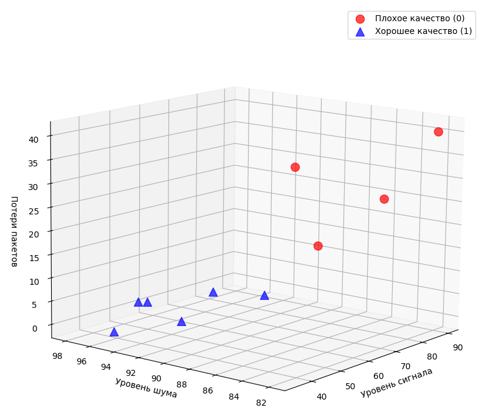
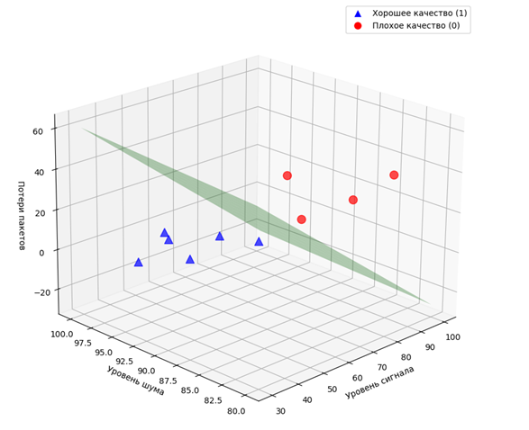

# Лабораторная работа №2. Метод опорных векторов (SVM)


Лабораторная работа по дисциплине «Методы машинного обучения», кафедра «Кибербезопасность информационных систем», ДГТУ, 2025.

## Цель

Изучить метод опорных векторов (Support Vector Machine, SVM) и применить его для бинарной классификации объектов в трёхмерном пространстве признаков.

## Метод опорных векторов (SVM)

### Идея

SVM — алгоритм машинного обучения для классификации и регрессии. В задаче классификации он ищет **разделяющую гиперплоскость**, которая отделяет объекты двух классов друг от друга **с максимальным зазором**. Чем шире свободная полоса между классами, тем увереннее классификатор работает на новых данных и тем меньше риск переобучения.

В трёхмерном пространстве признаков гиперплоскость — это обычная плоскость:

$$\mathbf{w}\cdot\mathbf{x}+b=0$$

где $\mathbf{w}=(w_1,w_2,w_3)$ — вектор весов (нормаль к плоскости), $b$ — смещение.

### Геометрия метода

- **Решающее правило.** Для нового объекта считается значение $f(\mathbf{x})=\mathbf{w}\cdot\mathbf{x}+b$. Если $f(\mathbf{x})>0$, объект относится к классу $+1$, если $f(\mathbf{x})<0$, то к классу $-1$.
- **Граничные плоскости.** Условие $\mathbf{w}\cdot\mathbf{x}+b=\pm 1$ задаёт две плоскости, параллельные разделяющей и проходящие через ближайшие к ней объекты каждого класса.
- **Зазор.** Ширина полосы между граничными плоскостями равна $\dfrac{2}{\lVert\mathbf{w}\rVert}$, где $\lVert\mathbf{w}\rVert$ — евклидова норма вектора весов.
- **Опорные векторы** — объекты, лежащие на граничных плоскостях. Только они определяют положение разделяющей плоскости: остальные объекты можно убрать, и решение не изменится.

### Математическая постановка (hard-margin SVM)

Классы кодируются метками $y_i\in\{+1,-1\}$. Максимизация зазора равносильна минимизации нормы вектора весов:

$$\min_{\mathbf{w},\,b}\ \frac12\lVert\mathbf{w}\rVert^2 \quad\text{при условии}\quad y_i(\mathbf{w}\cdot\mathbf{x}_i+b)\ge 1,\quad i=1,\dots,n$$

Условие означает, что каждый объект лежит по правильную сторону от своей граничной плоскости. «Жёсткий» зазор (hard margin) допускает решение только для **линейно разделимых** данных.

В двойственной форме решение записывается через опорные векторы:

$$\mathbf{w}=\sum_i \alpha_i y_i\,\mathbf{x}_i,$$

где коэффициенты $\alpha_i$ отличны от нуля только у опорных векторов.

### Как метод реализован в лабораторной работе

В работе используется учебный вариант метода, в котором решение сводится к системе из двух линейных уравнений.

1. **Поиск опорных векторов.** Перебираются все пары «объект класса 1 — объект класса 0», и выбирается пара с наименьшим евклидовым расстоянием. Эти два объекта считаются опорными: $S_1$ (класс $+1$) и $S_2$ (класс $-1$).
2. **Расширение векторов.** К каждому вектору добавляется единица: $S=(x_1,x_2,x_3,1)$. Благодаря этому смещение $b$ становится четвёртой компонентой искомого вектора $W=(w_1,w_2,w_3,b)$, и не нужно искать его отдельно.
3. **Система уравнений.** Опорные векторы должны лежать на граничных плоскостях: $f(S_1)=+1$, $f(S_2)=-1$. С учётом $W=\alpha_1 S_1+\alpha_2 S_2$ это даёт систему:

Система уравнений для коэффициентов:

```text
⎧ α₁·(S₁·S₁) + α₂·(S₁·S₂) = +1
⎨
⎩ α₁·(S₂·S₁) + α₂·(S₂·S₂) = −1
```

Её матрица Грама:

```text
G = ⎡ S₁·S₁  S₁·S₂ ⎤
    ⎣ S₂·S₁  S₂·S₂ ⎦
```

Система разрешима, если её определитель `det G ≠ 0`.

4. **Вектор W.** Находится как `W = α₁·S₁ + α₂·S₂`.
   Первые три компоненты — веса `w`, четвёртая — смещение `b`.

5. **Плоскость и классификация.** По `w` и `b` строится плоскость
   `w₁x + w₂y + w₃z + b = 0`, а класс нового объекта определяется
   знаком `f(x)`.

### Ограничения

- Hard-margin SVM работает только на линейно разделимых данных и чувствителен к выбросам. Для данных с пересечением классов применяют мягкий зазор (параметр $C$), для нелинейных границ — ядра (например, RBF).
- Поиск опорных векторов как пары ближайших объектов — упрощение. В общем случае опорных векторов может быть больше двух, а их находят решением задачи квадратичного программирования. В этой работе проверка показала, что опорными действительно являются те же два объекта.

## Задача и данные

Оценить пригодность защищённого Wi-Fi канала связи для безопасной передачи данных по трём признакам: уровень сигнала (dBm), уровень шума (dBm) и потеря пакетов (%). Итог: `1` — хорошее качество, `0` — плохое.

| № | Уровень сигнала | Уровень шума | Потеря пакетов | Итог |
| - | :-: | :-: | :-: | :-: |
| 1 | 35 | 95 | 0 | 1 |
| 2 | 45 | 92 | 2 | 1 |
| 3 | 65 | 90 | 5 | 1 |
| 4 | 75 | 88 | 15 | 0 |
| 5 | 55 | 98 | 1 | 1 |
| 6 | 85 | 85 | 25 | 0 |
| 7 | 80 | 91 | 30 | 0 |
| 8 | 50 | 96 | 3 | 1 |
| 9 | 90 | 82 | 40 | 0 |
| 10 | 60 | 93 | 5 | 1 |
| **11** | 60 | 85 | 20 | **?** |

Нужно определить качество канала для объекта №11.



## Программа

| Функция | Что делает |
| ------- | ---------- |
| `min_distance_between_opposite_points` | Находит пару ближайших объектов разных классов и возвращает их расширенные векторы $S_1$, $S_2$ |
| `solve_for_a1_a2` | Строит матрицу Грама, решает систему и выводит $\det G$, $\alpha_1$, $\alpha_2$ |
| `compute_W` | Вычисляет $W=\alpha_1 S_1+\alpha_2 S_2$ |
| `plot_hyperplane` | Рисует плоскость $w_1x+w_2y+w_3z+b=0$ на трёхмерном графике |

## Результаты

- **Опорные векторы:** объект №3 `(65, 90, 5)` класса 1 и объект №4 `(75, 88, 15)` класса 0.
- **Матрица Грама:**

```text

    ⎛ 12351  12871 ⎞
G = ⎜              ⎟ ,   det G = 2 249 204
    ⎝ 12871  13595 ⎠
```
- **Коэффициенты:** $\alpha_1\approx 0{,}01177$, $\alpha_2\approx -0{,}01121$.
- **Вектор весов и смещение:** $\mathbf{w}\approx(-0{,}0762;\ 0{,}0722;\ -0{,}1094)$, $b\approx 0{,}0006$.
- **Разделяющая плоскость:** $-0{,}0762\,x+0{,}0722\,y-0{,}1094\,z+0{,}0006=0$.



**Проверка.** Для всех 10 объектов выполняется условие $y_i\,f(\mathbf{x}_i)\ge 1$, причём равенство достигается у опорных векторов №3 и №4. Значит, данные линейно разделимы, а плоскость разделяет классы без ошибок. Стандартная реализация (scikit-learn, линейный `SVC` с большим `C`) даёт те же опорные векторы.

**Классификация объекта №11.** $f(60,\,85,\,20)\approx -0{,}62<0$, поэтому объект относится к классу **0 — плохое качество сигнала**. Он лежит по ту же сторону плоскости, что и объекты с большими потерями пакетов и низким уровнем шума.

## Запуск

```bash
pip install numpy matplotlib
python lab_2.py
```