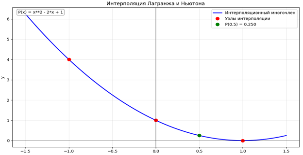

# Лабораторная работа №3. Интерполирование функций


Лабораторная работа по дисциплине «Методы машинного обучения», кафедра «Кибербезопасность информационных систем», ДГТУ, 2025.

## Цель

Изучить методы интерполирования функций (на примере интерполяционного многочлена Лагранжа и интерполяционного многочлена Ньютона) и применить их для восстановления значений функции по заданным узлам.

## Теоретический обзор и алгоритмы

Интерполяция функций — это метод аппроксимации, позволяющий восстановить неизвестные значения функции на основе её известного набора дискретных точек (узлов). В данной работе рассматриваются два классических метода.

---

### 1. Интерполяционный многочлен Лагранжа

#### Идея
Многочлен Лагранжа строится как линейная комбинация базисных полиномов. Каждый базисный полином принимают значение $1$ в конкретном узле $x_i$ и $0$ во всех остальных заданных узлах. В результате сумма таких полиномов, умноженных на значения функции в узлах, точно проходит через все заданные точки.

#### Формула
Интерполяционный многочлен Лагранжа степени $n$ для $n+1$ узла задается формулой:

$$L_n(x) = \sum_{i=0}^{n} y_i \prod_{\substack{j=0 \\ j \neq i}}^{n} \frac{x - x_j}{x_i - x_j}$$

#### Алгоритм реализации в коде (`lagrange_interpolation`)
1. Задается количество точек $n = \text{len}(x\_points)$ и начальное значение результата `result = 0.0`.
2. Внешний цикл перебирает каждый узел $i$ от $0$ до $n-1$ в качестве текущего слагаемого.
3. Внутренний цикл вычисляет базисный полином $L_i(x)$ для текущего узла:
   - Инициализируется переменная `L_i = 1.0`.
   - Для каждого другого узла $j \neq i$ к произведению домножается дробь $\frac{x - x_j}{x_i - x_j}$.
4. Полученный базисный полином умножается на значение $y_ при $i$ и добавляется к общему результату.

---

### 2. Интерполяционный многочлен Ньютона (через разделенные разности)

#### Идея
В отличие от Лагранжа, многочлен Ньютона удобен тем, что при добавлении новых узлов интерполяции не нужно пересчитывать всю формулу заново — достаточно добавить новое слагаемое. Для неравноотстоящих узлов используются *разделенные разности*.

#### Формула
Многочлен Ньютона запишется в виде:

$$P_n(x) = f(x_0) + f(x_0, x_1)(x - x_0) + f(x_0, x_1, x_2)(x - x_0)(x - x_1) + \dots + f(x_0, x_1, \dots, x_n)(x - x_0)\dots(x - x_{n-1})$$

где разделенные разности первого, второго и $k$-го порядков вычисляются рекурсивно:
- $f(x_i, x_{i+1}) = \frac{f(x_{i+1}) - f(x_i)}{x_{i+1} - x_i}$
- $f(x_i, x_{i+1}, x_{i+2}) = \frac{f(x_{i+1}, x_{i+2}) - f(x_i, x_{i+1})}{x_{i+2} - x_i}$

#### Алгоритм реализации в коде (`divided_differences` и `newton_interpolation`)
1. **Построение таблицы разделенных разностей (`divided_differences`):**
   - Создается квадратная матрица `table` размером $n \times n$.
   - Первый столбец заполняется исходными значениями функции $y_i$.
   - В цикле по порядку разности $j$ от $1$ до $n-1$ вычисляются значения разделенных разностей для каждого элемента по формуле разности соседних элементов предыдущего столбца, деленной на разность соответствующих координат $x$.
2. **Вычисление значения многочлена (`newton_interpolation`):**
   - Коэффициенты многочлена берутся из первой строки таблицы разделенных разностей (`coefficients = table[0]`).
   - Инициализируется `result = coefficients[0]` и `product = 1.0`.
   - В цикле последовательно добавляются слагаемые: к произведению `product` на каждом шаге домножается скобка $(x - x_{i-1})$, после чего прибавляется вклад нового коэффициента.

---

## Задача и исходные данные

Вариант №3. Дана таблица значений функции:

| № | $x$ | $y$ |
| - | :-: | :-: |
| 0 | -1 | 4 |
| 1 | 0 | 1 |
| 2 | 1 | 0 |
| **3** | **0.5** | **?** |

Требуется найти значение функции в точке $x = 0.5$ с помощью интерполяционных многочленов Лагранжа и Ньютона.

## Программа

| Функция | Что делает |
| ------- | ---------- |
| `lagrange_interpolation` | Вычисляет значение многочлена Лагранжа в заданной точке $x$ |
| `divided_differences` | Строит матрицу разделенных разностей для неравноотстоящих узлов |
| `newton_interpolation` | Вычисляет значение многочлена Ньютона через таблицу разделенных разностей |

## Результаты

- **Таблица разделенных разностей:**
  $$\begin{array}{r|rrr}
  x_0 = -1 & 4.000 & -3.000 & 1.000 \\
  x_1 = 0 & 1.000 & -1.000 & \\
  x_2 = 1 & 0.000 & &
  \end{array}$$

- **Построенный полином:** В результате аналитических преобразований и расчетов оба метода дают единый интерполяционный многочлен:
  $$P(x) = x^2 - 2x + 1$$

- **Интерполяция в точке $x = 0.5$:**
  - Метод Лагранжа: **$0.25$**
  - Метод Ньютона: **$0.25$**



*Рисунок 1 – График интерполяционного многочлена и узлов интерполяции*

## Запуск

```bash
pip install matplotlib
python lab_3.py
```